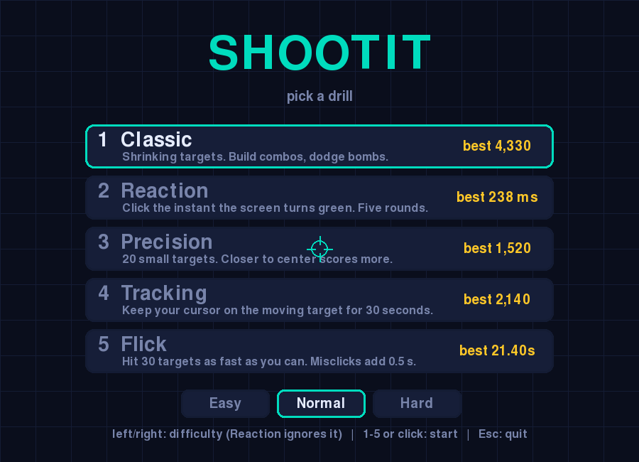
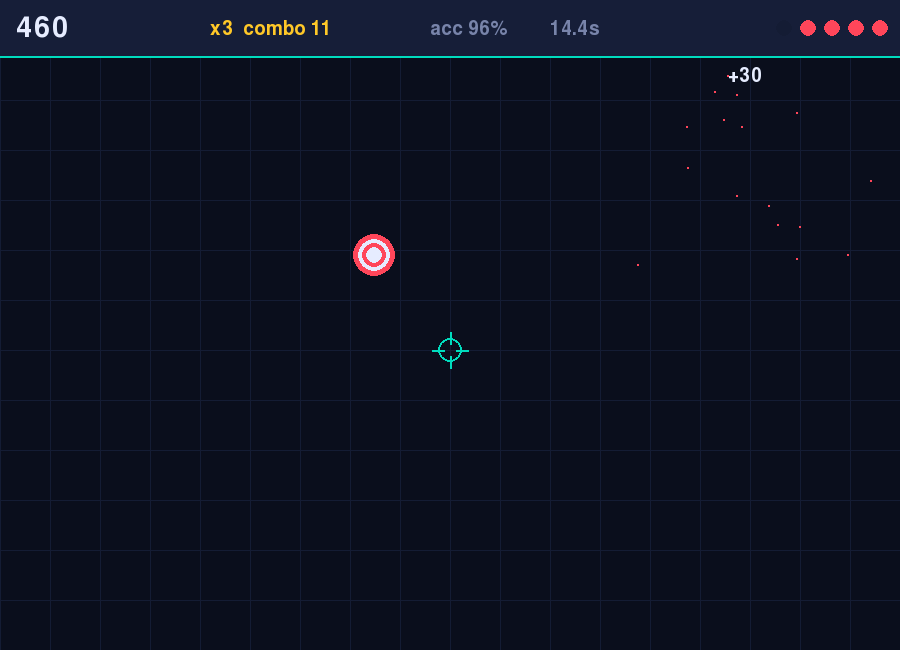

# Aim Trainer

 

A fast arcade aim trainer built with Python and [pygame-ce](https://pyga.me/). Five short drills for aim, accuracy, focus and reaction time, with saved best scores. Landing page: https://aweebtaku.github.io/Aim-Trainer/

<p align="center"> </p>

## Drills

| Drill | Trains | How it works |
|-------|--------|--------------|
| **Classic** | Aim under pressure | Targets pop up and shrink away. Build combos (up to x8), grab gold (+life), never click bombs. Ends when you run out of lives |
| **Reaction** | Reaction time | Wait for the screen to turn green, then click. Five rounds, scored by your average in ms. Clicking early repeats the round |
| **Precision** | Accuracy | 20 small static targets, no time pressure. Up to 100 points per shot depending on how close to the center you land |
| **Tracking** | Focus | Keep your cursor on a moving target for 30 seconds. Scored by time on target |
| **Flick** | Speed and flick aim | Hit 30 targets as fast as you can. Each misclick adds 0.5 s. Lower time is better |

## Features

- **Three difficulties** (Easy / Normal / Hard): lives, target size and speed change. Reaction ignores difficulty
- **Humane pacing**: Classic eases up over the first 3 minutes (targets end up at most 30% faster), then holds steady
- Particles, floating score popups, screen shake, custom crosshair
- **Persistent best scores** per drill and difficulty
- End-of-run stats for every drill

## Download

Grab the file for your system from the [Releases page](../../releases/latest). `x64` is Intel/AMD, `arm64` is ARM (Apple Silicon, Raspberry Pi 4/5, etc.).

| System | File | Install |
|--------|------|---------|
| Windows 10/11 | `Aim-Trainer-windows-x64-setup.exe` (current user, no admin needed) or `Aim-Trainer-windows-x64.msi` (all users) | Double-click it. If SmartScreen warns, choose *More info > Run anyway* (unsigned) |
| macOS | `Aim-Trainer-macos-arm64.dmg` (Apple Silicon) or `Aim-Trainer-macos-x64.dmg` (Intel) | Open the dmg, drag Aim Trainer to Applications. First launch: right-click > *Open* (unsigned) |
| Debian, Ubuntu, Mint | `Aim-Trainer-linux-x64.deb` | `sudo apt install ./Aim-Trainer-linux-x64.deb` |
| Fedora, openSUSE | `Aim-Trainer-linux-x64.rpm` | Fedora: `sudo dnf install ./Aim-Trainer-linux-x64.rpm`. openSUSE: `sudo zypper --no-gpg-checks install ./Aim-Trainer-linux-x64.rpm` |
| Arch, Manjaro | `Aim-Trainer-linux-x64.pkg.tar.zst` | `sudo pacman -U Aim-Trainer-linux-x64.pkg.tar.zst` |
| Any Linux | `Aim-Trainer-linux-x64.AppImage` | `chmod +x Aim-Trainer-linux-x64.AppImage && ./Aim-Trainer-linux-x64.AppImage` |

On ARM Linux, replace `x64` with `arm64` in the file names.

- **Remove (Linux packages):** `sudo apt remove aim-trainer`, `sudo dnf remove aim-trainer`, `sudo zypper remove aim-trainer` or `sudo pacman -R aim-trainer`. The deb, rpm and pacman packages add a menu entry, or run `aim-trainer` in a terminal.
- **AppImage** needs FUSE 2 (Ubuntu: `sudo apt install libfuse2`, or `libfuse2t64` on 24.04+). Without it, run `./Aim-Trainer-linux-x64.AppImage --appimage-extract-and-run`.
- **Linux requirements:** a desktop session (X11 or Wayland) and glibc 2.35 or newer (Ubuntu 22.04+, Debian 12+, Fedora 36+, current Arch). On older systems, run from source.
- **Windows and macOS** installers are unsigned, so you will see an "unknown developer" warning on first run.

## Run from source

Needs Python 3.9+.

```bash
git clone https://github.com/AWeebTaku/Aim-Trainer.git
cd Aim-Trainer
python -m venv .venv
```

Activate the virtual environment:

| Shell | Command |
|-------|---------|
| Linux / macOS | `source .venv/bin/activate` |
| Windows PowerShell | `.venv\Scripts\Activate.ps1` |
| Windows cmd | `.venv\Scripts\activate.bat` |

Then:

```bash
pip install -r requirements.txt
python main.py
```

### Linux notes

If `python -m venv` fails, install the venv package first:

| Distro | Command |
|--------|---------|
| Debian / Ubuntu / Mint | `sudo apt install python3 python3-venv python3-pip` |
| Fedora | `sudo dnf install python3 python3-pip` |
| Arch / Manjaro | `sudo pacman -S python python-pip` |
| openSUSE | `sudo zypper install python3 python3-pip` |

Arch and other distros with "externally managed" Python (PEP 668) require the virtual environment above. Do not use `pip install` system-wide.

### Troubleshooting

- **Use `pygame-ce`, not `pygame`.** They share the `import pygame` name and conflict when both are installed. If you see font or import errors (common on Python 3.13+), run `pip uninstall pygame && pip install --force-reinstall pygame-ce`.
- **No window on Wayland-only setups:** try `SDL_VIDEODRIVER=wayland python main.py` or `SDL_VIDEODRIVER=x11 ...`.
- **High scores** are stored per user: `~/.local/share/Aim-Trainer/Aim-Trainer/` (Linux), `~/Library/Application Support/Aim-Trainer/Aim-Trainer/` (macOS), `%APPDATA%\Aim-Trainer\Aim-Trainer\` (Windows). Delete `highscores.json` there to reset.

## Controls

| Key | Action |
|-----|--------|
| `1` to `5`, arrows + `Enter`, or click | Pick and start a drill |
| `Left` / `Right` (menu) | Change difficulty |
| Mouse click | Shoot |
| `P` / `Space` | Pause |
| `R` | Retry (game over) |
| `M` | Back to menu |
| `Esc` | Quit |

## Releases and building

Every push to `main` builds all platforms in GitHub Actions (download from the run's *Artifacts*). To publish a release, push a version tag:

```bash
git tag v1.0.0
git push origin v1.0.0
```

The workflow in `.github/workflows/release.yml` then attaches the Windows, macOS and Linux builds to a new GitHub Release.

To build locally for your own OS:

```bash
pip install pyinstaller
pyinstaller --onefile --noconsole --name Aim-Trainer main.py   # use --windowed instead on macOS
```

The result is in `dist/` (not tracked in git). The installers (setup.exe, msi, dmg, deb, rpm, pkg.tar.zst, AppImage) are built in CI: see `.github/workflows/release.yml` and `packaging/`.
