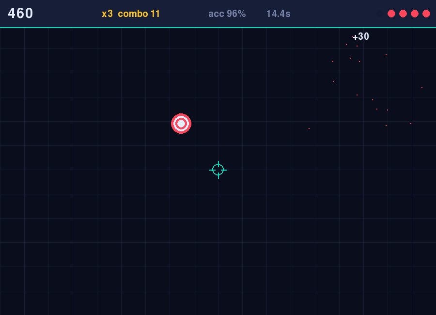
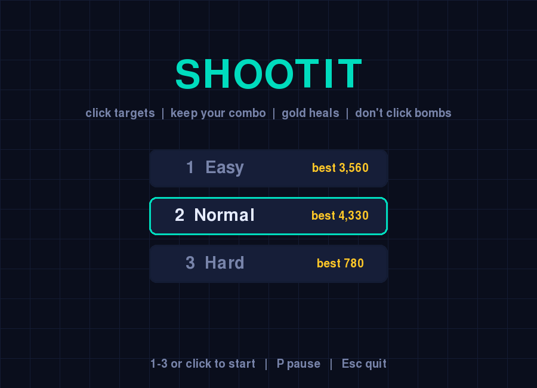

# Shootit

 

A fast arcade aim trainer built with Python and [pygame-ce](https://pyga.me/). Targets pop up and shrink away. Click them before they vanish, keep your combo alive, and don't touch the bombs.

<p align="center"> </p>

## Features

- **Three difficulties** (Easy / Normal / Hard) with different lives and spawn speeds
- **Combo multiplier**: every 5 hits in a row raises your multiplier, up to x8. Missing a click resets it
- **Gold targets** are worth 5x and restore a life
- **Bombs** (purple) cost a life if you click them. Let them fade
- **Difficulty ramps** the longer you survive
- Particles, floating score popups, screen shake, custom crosshair
- **Persistent high scores** per difficulty
- End-of-run stats: accuracy, targets/sec, best combo, time

## Download

Grab the build for your system from the [Releases page](../../releases/latest):

| System | File | How to run |
|--------|------|-----------|
| Windows 10/11 (x64) | `Shootit-windows-x64.zip` | Unzip, double-click `Shootit.exe`. If SmartScreen warns, choose *More info > Run anyway* (the build is unsigned) |
| macOS, Apple Silicon | `Shootit-macos-arm64.zip` | Unzip, then right-click `Shootit.app` > *Open* the first time (unsigned) |
| macOS, Intel | `Shootit-macos-x64.zip` | Same as above |
| Linux, any distro | `Shootit-linux-x64.tar.gz` / `Shootit-linux-arm64.tar.gz` | `tar xzf Shootit-linux-x64.tar.gz && ./Shootit` |

### Linux packages

Native packages install `shootit` to `/usr/bin` and add a menu entry with an icon. Use `x64` for Intel/AMD and `arm64` for ARM (Raspberry Pi 4/5, etc.).

| Distro | File | Install | Remove |
|--------|------|---------|--------|
| Debian, Ubuntu, Mint, Pop!_OS | `Shootit-linux-x64.deb` | `sudo apt install ./Shootit-linux-x64.deb` | `sudo apt remove shootit` |
| Fedora, RHEL, Rocky, Alma | `Shootit-linux-x64.rpm` | `sudo dnf install ./Shootit-linux-x64.rpm` | `sudo dnf remove shootit` |
| openSUSE | `Shootit-linux-x64.rpm` | `sudo zypper --no-gpg-checks install ./Shootit-linux-x64.rpm` | `sudo zypper remove shootit` |
| Arch, Manjaro, EndeavourOS | `Shootit-linux-x64.pkg.tar.zst` | `sudo pacman -U Shootit-linux-x64.pkg.tar.zst` | `sudo pacman -R shootit` |

Swap `x64` for `arm64` in the file names on ARM machines. Then launch from your app menu or run `shootit`.

The packages are unsigned and need no extra dependencies. All Linux builds need a desktop session (X11 or Wayland) and glibc 2.35 or newer (Ubuntu 22.04+, Debian 12+, Fedora 36+, current Arch). On older systems, run from source.

## Run from source

Needs Python 3.9+.

```bash
git clone https://github.com/AWeebTaku/Aim-Trainer.git
cd Aim-Trainer
python -m venv .venv
```

Activate the virtual environment:

| Shell | Command |
|-------|---------|
| Linux / macOS | `source .venv/bin/activate` |
| Windows PowerShell | `.venv\Scripts\Activate.ps1` |
| Windows cmd | `.venv\Scripts\activate.bat` |

Then:

```bash
pip install -r requirements.txt
python Shootit.py
```

### Linux notes

If `python -m venv` fails, install the venv package first:

| Distro | Command |
|--------|---------|
| Debian / Ubuntu / Mint | `sudo apt install python3 python3-venv python3-pip` |
| Fedora | `sudo dnf install python3 python3-pip` |
| Arch / Manjaro | `sudo pacman -S python python-pip` |
| openSUSE | `sudo zypper install python3 python3-pip` |

Arch and other distros with "externally managed" Python (PEP 668) require the virtual environment above. Do not use `pip install` system-wide.

### Troubleshooting

- **Use `pygame-ce`, not `pygame`.** They share the `import pygame` name and conflict when both are installed. If you see font or import errors (common on Python 3.13+), run `pip uninstall pygame && pip install --force-reinstall pygame-ce`.
- **No window on Wayland-only setups:** try `SDL_VIDEODRIVER=wayland python Shootit.py` or `SDL_VIDEODRIVER=x11 ...`.
- **High scores** are stored per user: `~/.local/share/Shootit/Shootit/` (Linux), `~/Library/Application Support/Shootit/Shootit/` (macOS), `%APPDATA%\Shootit\Shootit\` (Windows). Delete `highscores.json` there to reset.

## Controls

| Key | Action |
|-----|--------|
| `1` `2` `3` or click | Pick difficulty / start |
| Mouse click | Shoot |
| `P` / `Space` | Pause |
| `R` | Retry (game over) |
| `M` | Back to menu |
| `Esc` | Quit |

## Releases and building

Every push to `main` builds all platforms in GitHub Actions (download from the run's *Artifacts*). To publish a release, push a version tag:

```bash
git tag v1.0.0
git push origin v1.0.0
```

The workflow in `.github/workflows/release.yml` then attaches the Windows, macOS and Linux builds to a new GitHub Release.

To build locally for your own OS:

```bash
pip install pyinstaller
pyinstaller --onefile --noconsole --name Shootit Shootit.py   # use --windowed instead on macOS
```

The result is in `dist/` (not tracked in git).
